  

  

  
  
  
  

---

### 👋 About me

I build the systems underneath production AI: cloud data warehouses, ETL pipelines, knowledge graphs and
memory for LLM agents.

- 🏢 **AI Engineer at [Codet.ai](https://app.codet.dev)**: architected the product analytics warehouse on GCP
  (Cloud Storage → DuckDB → PostgreSQL cubes) and work on **CHHG**, the graph knowledge engine behind all of the company's AI agents
- 🧠 Interested in agent memory, hybrid retrieval and data-quality-first analytics
- 🎓 BS Computer Science, FAST-NUCES Karachi

### 🛠️ Tech stack

  

  
  
  
  
  
  
  
  
  

### 🚀 Projects

#### 🤖 AI agents & LLM systems

| Project | What it is | Stack |
|---|---|---|
| 📊 [**TrueMetric**](https://github.com/murtazaahmedd/analytics-agent) | AI data agent that answers business questions only through an approved metric layer, checks the data first and refuses rather than guesses. 0 confidently wrong answers across a 121-question eval. | Python agent state machine, dbt, MetricFlow, DuckDB, MCP, LiteLLM |
| 📞 [**Voice AI Patient Registration**](https://github.com/murtazaahmedd/calling-agent) | Phone agent that registers or updates patients by voice, backed by a validated REST API. | Vapi, FastAPI, PostgreSQL, Render |

#### 🧪 Machine learning & computer vision

| Project | What it is | Stack |
|---|---|---|
| ⚡ [**SADIN Energy Forecasting**](https://github.com/murtazaahmedd/sadinhub) | Daily kWh forecasting, bill estimation and anomaly alerts for 31 meters. 95.3% facility day-ahead accuracy under walk-forward replay. | Huber regression, LightGBM, Isolation Forest, PostgreSQL, FastAPI |
| 🎥 [**Vigilant Vision**](https://github.com/murtazaahmedd/VV) | Real-time CCTV analytics (final-year project): custom YOLO detectors for face masks, queues and smoke, plus a crowd-counting model, with a live alert dashboard. | YOLO, TensorFlow, OpenCV, Flask, React, SQLite |
| 🥔 [**Potato Leaf Disease**](https://github.com/murtazaahmedd/potato_leaf_disease) | Keras CNN with data augmentation for 3-class leaf disease classification, 94.6% test accuracy, served through an API and web app. | TensorFlow, Keras, FastAPI, React |
| 🔥 [**Algerian Forest Fire Prediction**](https://github.com/murtazaahmedd/Algerain-Forest--Linear-Regression-Project) | Predicts the Fire Weather Index from weather readings with a scaled Ridge regression model, deployed as a Flask web app. | scikit-learn, pandas, Flask |

#### 🏗️ Data engineering & analytics

| Project | What it is | Stack |
|---|---|---|
| 🚦 [**Karachi Surge**](https://github.com/murtazaahmedd/karachi-surge) | Real-time streaming engine for Karachi traffic and ride prices, with live pollers and NYC trip replay. | Redpanda (Kafka), TimescaleDB, Redis, H3, Docker |
| 🏏 [**IPL Match Analytics**](https://github.com/murtazaahmedd/ipldataanalysis-end-to-end-data-engineering-project) | Ball-by-ball IPL data pipeline: extraction, cleaning and transformations in Spark, then analysis of team and player performance. | Apache Spark, PySpark, Spark SQL |
| 🏆 [**T20 World Cup Analytics**](https://github.com/murtazaahmedd/t20_worldcup_analysis) | Cleans raw match and player JSON into a star schema (match, player, batting and bowling tables) and builds a Power BI dashboard of batting and bowling performance. | Python, pandas, Power BI |

#### 🌐 Web

| Project | What it is | Stack |
|---|---|---|
| 🕸️ [**Interactive Portfolio**](https://murtazaahmedd.github.io) ([code](https://github.com/murtazaahmedd/murtazaahmedd.github.io)) | My portfolio as an explorable knowledge graph, with search, path-finding between skills and projects, and a timeline. | JavaScript, D3.js, HTML/CSS |

### 💼 Experience

| | Role | When |
|---|---|---|
| **Codet.ai** | AI Engineer | 2025 to present |
| **TallyMarks Consulting** | Data & Planning Management Trainee | 2025 |
| **Systems Limited** | Data Engineering Intern | 2024 |

### 📈 GitHub activity

  
  

  

